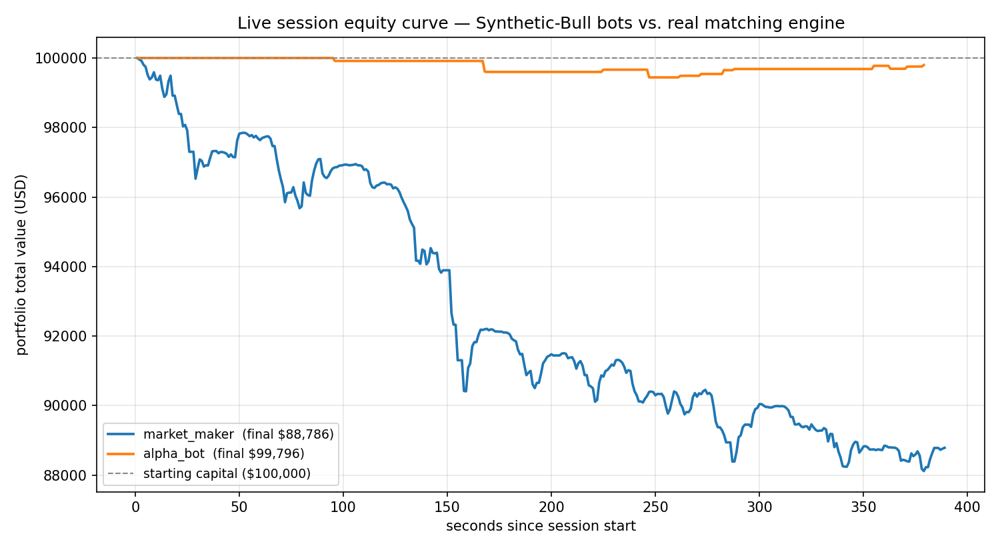

# Performance & Benchmarks

Two separate things are measured here, and they should not be confused:

1. **Matching-engine performance** — a pure, dependency-free micro-benchmark
   of `OrderBook` itself (no network, no JSON, no WebSocket layer). Answers
   "how fast is the actual matching logic."
2. **Bot performance** — real P&L captured from a live session: the actual
   C++ backend running, the actual GBM price feed running, both Python bots
   connected over a real WebSocket and trading against the real order book.
   Answers "do these strategies make money against this market," which is a
   completely different question from #1 and is *not* something you can
   answer by reading the strategy code.

Both were run once, honestly, and reported as-is below — including the
result nobody would put in a README by choice (the market maker lost money).
That's the point: a chart and a table prove something reading the source
can't.

---

## 1. Matching-engine latency & throughput

**Harness:** [`backend/bench/latency_bench.cpp`](backend/bench/latency_bench.cpp)
— feeds `OrderBook` 500,000 orders shaped like real traffic on this exchange
(80% resting limit orders around a random-walking mid, 12% market orders that
sweep the book, 8% cancels — modeled on the GBM feed + market-maker re-quote
+ alpha-bot flatten/enter behavior described in the main README), timing
each `addLimitOrder` / `addMarketOrder` / `cancelOrder` call individually
with `std::chrono::steady_clock`.

Run it yourself: `cd backend/bench && ./run_bench.sh 500000`

**Environment this was measured on:** single-threaded, 2 vCPU cloud sandbox
(Intel Xeon @ 2.10 GHz), `-O2`. This is *not* production trading hardware —
treat the absolute numbers as "what a modest cloud box does," and the
relative shape (sub-microsecond median, low-microsecond tail) as the
meaningful result. Re-run `run_bench.sh` on your own machine for numbers
that mean something for your hardware.

| Metric | Value |
|---|---|
| Orders processed | 500,000 |
| Throughput | ~1.35M ops/sec (single-threaded, library-level) |
| Latency p50 | 0.45 µs |
| Latency p95 | 1.4 µs |
| Latency p99 | 2.3 µs |
| Latency p99.9 | 9.3 µs |
| Latency max | ~800 µs (occasional page fault / allocator spike — not a queue-depth effect, since `std::map`/`std::deque` allocate per-insert) |

Three consecutive runs at 500k orders varied by <7% on throughput and <5%
on p50/p99 — noise, not a trend.

**What this excludes, on purpose:** the WebSocket layer, JSON
(de)serialization, the per-connection mutex in `Exchange`, and OS network
I/O. End-to-end client-perceived latency (order sent → `order_ack`
received) will be higher and is dominated by those layers, not by
`OrderBook`. This benchmark isolates the one component that's actually
interesting to measure in isolation — the matching algorithm itself — the
same reason `backend/tests/` tests `OrderBook` directly instead of through
the live server.

---

## 2. Live bot session — equity curves & risk stats

**Harness:** `bots/portfolio_logger.py` (wired into both bots — logs every
`portfolio` update to CSV) + `bots/analyze_session.py` (turns one or more
CSVs into an equity curve and the table below).

**Session:** ~6.5 minutes, real backend, real GBM feed, both bots connected
simultaneously and trading against each other and the simulator. Reproduce
it yourself:

```bash
cd backend && ./build.sh && ./synthetic-bull &
cd bots && pip install websockets pandas numpy matplotlib
python3 market_maker.py &
python3 alpha_bot.py &
# let it run, then:
python3 analyze_session.py logs/market_maker_portfolio.csv logs/alpha_bot_portfolio.csv
```



| Bot | Duration | Snapshots | Start | End | Return | Max Drawdown | Sharpe (session) | Sharpe (naive annualized)* | Closing events | Win rate |
|---|---|---|---|---|---|---|---|---|---|---|
| market_maker | 389s | 637 | $100,000.01 | $88,785.82 | -$11,214.19 (-11.21%) | -$11,883.39 (-11.88%) | -2.79 | -797.02 | 325 (93W / 232L) | 28.6% |
| alpha_bot | 379s | 32 | $100,000.00 | $99,795.73 | -$204.27 (-0.20%) | -$557.70 (-0.56%) | -0.46 | -132.52 | 15 (9W / 6L) | 60.0% |

Raw data: [`docs/benchmarks/sample_market_maker_session.csv`](docs/benchmarks/sample_market_maker_session.csv), [`docs/benchmarks/sample_alpha_bot_session.csv`](docs/benchmarks/sample_alpha_bot_session.csv).

**On the two Sharpe columns:** `analyze_session.py` resamples the equity
curve to 1-second bars and computes `mean(returns) / std(returns)`. Scaling
that by `sqrt(periods observed)` gives a number that's actually about *this
session* (**Sharpe (session)** — the one to look at). Scaling it instead by
`sqrt(seconds in a year)`, which is the textbook annualization formula,
produces the second column — and it's included specifically to show why
that number is meaningless here: projecting six minutes of 1-second returns
out to a year massively amplifies noise, and 1-second paper-trading returns
aren't IID to begin with. A large negative "annualized Sharpe" from a few
minutes of data is not evidence of a large negative annual Sharpe; it's an
artifact of the scaling. This is a standard trap in retail backtest write-ups
and deliberately left visible here rather than hidden.

### Reading the result honestly

**Alpha bot:** roughly flat (-0.2%) over the session, 60% win rate on 15
closing trades, max drawdown under $600. Consistent with a momentum strategy
that gets some crossovers right and is protected from tail losses by its
$500 hard stop — not enough trades in 6 minutes to say anything statistically
meaningful about edge, but nothing here looks broken.

**Market maker:** lost 11.2% of capital in under 7 minutes, with realized
P&L bleeding steadily rather than in one bad trade (see the chart — it's a
slope, not a cliff) and a 28.6% win rate on individual closing trades. That's
**adverse selection**: an $8 fixed half-spread quoted continuously into a
market where a chunk of the flow (the GBM simulator's own price-discovery
crossing orders, plus the momentum bot's directional market orders) is
*informed* relative to the maker's stale quote. Every time the mid price
moves before the maker re-quotes (every 800ms), one side of its resting
quote is now mispriced, and getting picked off on the mispriced side faster
than the spread can pay for it is exactly the textbook failure mode of naive
fixed-spread market making. Two concrete next steps this session's data
points at directly: widen `BASE_SPREAD` or shorten `QUOTE_INTERVAL` (or
both), and size the spread to recent realized volatility instead of a fixed
constant.

### A bug this benchmark caught before it shipped

Capturing this session surfaced a real defect: `market_maker.py` used to
stop quoting *entirely* once `|inventory| >= MAX_INVENTORY` and never
resumed, because it only ever placed both sides of the quote or neither —
so a position that hit the cap was stuck there, with zero ability to trade
back within limits, for the rest of the process's life. In the first attempt
at this session the bot capped out at inventory 5.12 around t=55s and then
produced no further data for the remaining ~6 minutes. Fixed in `requote()`
to quote only the inventory-*reducing* side once at the cap, instead of
going silent — the session above is the bot running with that fix. This is
the kind of bug that's easy to miss reading the code (the branch looks like
a reasonable risk control) and hard to miss watching real P&L stop updating
for six minutes straight.

---

## Reproducing these numbers

Both harnesses are checked in and runnable standalone — no CI, no special
setup beyond what the main README already asks for:

```bash
# Matching-engine latency/throughput
cd backend/bench && ./run_bench.sh 500000

# Live bot session (run the backend first, in another terminal)
cd bots
python3 market_maker.py &
python3 alpha_bot.py &
#   ... let it run ...
python3 analyze_session.py logs/*.csv
```

`bots/logs/` is gitignored — every run overwrites it locally. The numbers
and chart above are one specific captured session, checked into
`docs/benchmarks/` as a reference point, not a live badge that updates
itself.
